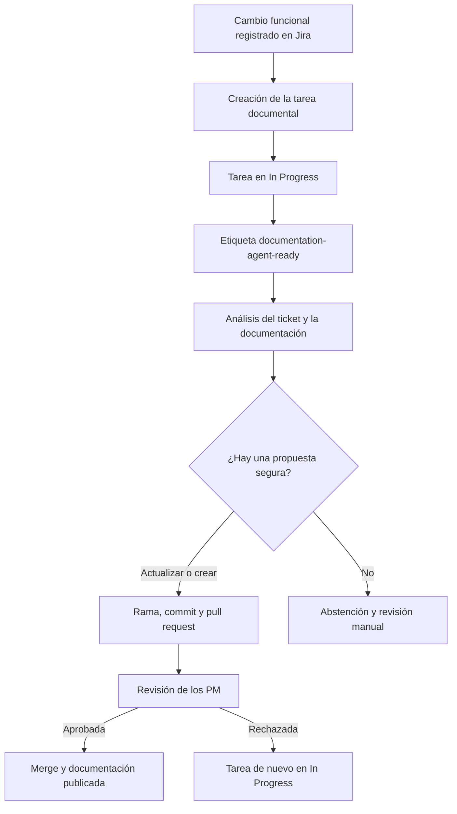

# Flujo del agente de documentación

## Objetivo

El agente convierte una necesidad documental registrada en Jira en una propuesta revisable en GitHub. Automatiza el análisis y la preparación del cambio, pero mantiene la decisión de publicación en manos de los PM.

## Flujo completo



## Obtención del contexto de Jira

Las tareas funcionales relevantes llevan la etiqueta `documentation-required` y se completan en **Done**. Al añadir `documentation-scope-ready` a la épica, Jira crea una sola tarea documental con `documentation-task`. El proyecto documental puede centralizar solicitudes de distintos proyectos y equipos: la tarea documental no necesita ser hija de la épica ni compartir su prefijo.

El flujo normal acepta `jira_epic_key` y `jira_task_keys` como referencias estructuradas, dejando `issue_description` libre para títulos, enlaces y contexto de los PM. Ejemplo de payload de `workflow_dispatch`:

```json
{
  "ref": "main",
  "inputs": {
    "issue_key": "DOC-999",
    "issue_summary": "Documentar las invitaciones",
    "issue_description": "# Contexto para PM\nRevisar invitaciones y permisos.\n[Diseño](https://example.invalid/diseno)",
    "jira_epic_key": "APP-123",
    "jira_task_keys": "APP-124, TEAM-125",
    "mode": "generate"
  }
}
```

Ambos inputs deben llegar juntos. La épica debe ser una única clave; las tareas se separan por comas, aceptando espacios alrededor de ellas. Se rechazan elementos vacíos, claves inválidas y duplicados antes de consultar Jira o Claude. El contrato de claves es `[A-Z][A-Z0-9]*(?:-[A-Z0-9]+)*-[1-9][0-9]*`; no se recortan espacios alrededor de la clave de épica. Un input estructurado inválido nunca activa el parser del manifiesto como alternativa.

Sin ninguno de los dos inputs, se conserva el mecanismo anterior: la descripción puede contener únicamente este manifiesto estricto:

```yaml
DOCUMENTATION_SOURCE_V1
EPIC_KEY: DOC-123
TASK_KEYS:
- DOC-124
- DOC-125
```

Cuando la tarea documental pasa a **In Progress**, el workflow recupera desde Jira Cloud la épica y las tareas de las referencias estructuradas o del manifiesto. Antes de usar el contenido, comprueba que la fuente principal es una épica y que cada tarea funcional es hija directa, conserva `documentation-required` y pertenece a la categoría Done. Las claves pueden tener prefijos diferentes; la relación se valida con el campo `parent` de Jira, sin consultar ni exigir parentesco a la tarea documental.

En modo estructurado se consulta también la solicitud documental por `ticket.issue_key`, con el cliente autenticado existente y el mismo conversor ADF. Su descripción actual de API es canónica: sustituye completamente la representación de Automation (`issue.description.jsonEncode`), sin concatenarlas ni usar esta última como fallback. Un fallo de lectura o conversión aborta antes de Claude. No se exige parentesco, etiqueta ni estado funcional a la solicitud, y leerla no autoriza sus adjuntos.

En ese modo, `ticket.issue_description` se compone en este orden: `Documentation task CLAVE: RESUMEN` (identidad y resumen del ticket de entrada), dos saltos de línea y la descripción canónica convertida; después `Epic CLAVE: RESUMEN` y la descripción completa de la épica convertida de ADF; después cada sección `Task CLAVE: RESUMEN` y su descripción completa convertida, en el orden de los inputs. Las secciones se unen con dos saltos de línea. Las descripciones recuperadas de Jira mantienen la conversión común y eliminan únicamente espacios exteriores. Todo el contexto, incluidos títulos y separadores, tiene un límite de 60.000 caracteres; si se supera, falla sin truncar y antes de preparar la petición. En modo manifiesto, se conserva exactamente la composición anterior de épica y tareas, sin consultar la solicitud ni añadir el manifiesto como contexto humano. El modo histórico sin fuentes sigue usando el ticket de entrada.

El contexto permanece dentro del ticket no confiable que recibe `build_request`, con las instrucciones de seguridad existentes. El JSON del ticket conserva exactamente `issue_key`, `issue_summary` e `issue_description`: las referencias se validan por separado y llegan al generador mediante `--jira-epic-key` y `--jira-task-keys`. Los consumidores de publicación y notificación siguen recibiendo el ticket original de tres campos.

Los nodos `codeBlock` se convierten en bloques Markdown delimitados, concatenando sus nodos `text` en orden y conservando literalmente el contenido, los saltos de línea y los espacios. El delimitador usa más backticks que cualquier secuencia del contenido para conservar también Markdown pegado dentro del bloque. Este texto se trata como evidencia y no se ejecuta ni se interpreta como instrucciones operativas.

Tanto el diagnóstico como el flujo normal comprueban cada descripción antes de preparar la petición a Claude. Si el ADF contiene texto distinto de espacios en blanco y el Markdown convertido queda vacío, el flujo falla con un error de pérdida de texto que identifica solo la clave Jira afectada. Una descripción ausente, sin texto o formada únicamente por espacios en blanco se considera realmente vacía y no provoca ese error.

El acceso usa autenticación básica de Jira Cloud y estos Repository Secrets, configurados solo en el paso que ejecuta el agente: `JIRA_BASE_URL`, `JIRA_API_EMAIL` y `JIRA_API_TOKEN`. Sus valores no se registran ni se incorporan a la tarea documental.

Las tareas documentales antiguas que no contienen `DOCUMENTATION_SOURCE_V1` mantienen el flujo anterior. Si el manifiesto está presente, no hay alternativa: cualquier error de formato, configuración, consulta, relación o validación detiene el flujo antes de llamar a Claude.

### Diagnóstico manual del contexto

El workflow **Documentation agent PoC** permite comprobar desde **Actions > Run workflow** que las descripciones completas de Jira llegan a la petición final preparada para Claude, sin enviarla.

1. Seleccionar en **Use workflow from** la rama que se quiere diagnosticar. El job de diagnóstico hace checkout de esa referencia, captura su SHA y lo verifica antes de consultar Jira y después de preparar la petición. El flujo automático normal continúa usando `main`.
2. Rellenar estos campos y seleccionar `mode=diagnose-context`:

   | Campo | Valor en diagnóstico | Valor en flujo normal |
   |---|---|---|
   | `issue_key` | Clave de la tarea documental, por ejemplo `DOC-999`; obligatorio | Obligatorio, sin cambios |
   | `issue_summary` | Resumen de la tarea documental; obligatorio | Obligatorio, sin cambios |
   | `issue_description` | Puede dejarse vacío: en modo estructurado se usa la descripción actual de la solicitud por API | Obligatorio por validación del job, aunque el formulario lo muestre opcional; conserva sus validaciones. En modo estructurado prevalece la descripción API |
   | `jira_epic_key` | Una clave de épica, por ejemplo `APP-123`; obligatorio cuando `mode=diagnose-context` | Opcional, junto con `jira_task_keys` activa el modo estructurado |
   | `jira_task_keys` | Claves separadas por comas, por ejemplo `APP-124, TEAM-125`; obligatorio cuando `mode=diagnose-context` | Opcional, junto con `jira_epic_key` activa el modo estructurado |
   | `mode` | `diagnose-context` | `generate` por defecto; omitir el campo también ejecuta generación. El booleano antiguo `diagnose_only` se sustituye por este selector |

3. El paso **Serialize diagnostic ticket input** valida las referencias con `parse_jira_source_inputs`, igual que el flujo normal. Rechaza campos ausentes, elementos vacíos —incluidas comas iniciales, finales o consecutivas—, claves inválidas, duplicados y texto adicional antes de exponer credenciales o consultar Jira. Conserva el ticket temporal de tres campos, sin construir un manifiesto; al resolver el contexto prevalece la descripción API. Para comparar una ejecución normal, usar los mismos inputs y el mismo estado de Jira.
4. El paso **Diagnose validated Jira context in the prepared request** recibe únicamente los tres secretos Jira indicados arriba. Lee la solicitud por su clave y consulta y valida la épica y las tareas hijas directas con las mismas funciones del flujo normal: tipo Epic, relación con la épica, etiqueta `documentation-required` y categoría Done. Convierte todas las descripciones ADF a Markdown y usa la misma composición de solicitud canónica, épica y tareas, sin truncarlo. Si el conjunto supera 60.000 caracteres, falla antes de construir la petición.
5. Lee `.github/prompts/documentation-agent-poc.md` y los documentos bajo `docs/` mediante las mismas funciones del flujo normal. Usa `build_request` con el mismo modelo, `max_tokens` y contrato. Deserializa el JSON del mensaje de usuario y compara exactamente `ticket.issue_description` con el contexto Jira consolidado.
6. Consultar el JSON del paso de diagnóstico en los logs. `contexts_match=true` confirma la coincidencia exacta. Si hay discrepancia, publica las métricas seguras con `contexts_match=false` y el paso termina con código de error. Un fallo de inputs, consulta, validación, lectura o SHA detiene el diagnóstico sin publicar el payload.

El job tiene únicamente `contents: read`, no persiste credenciales de Git y no recibe ni lee `ANTHROPIC_API_KEY`. Lee los inputs desde el archivo local del evento (`GITHUB_EVENT_PATH`), evitando que Actions muestre el resumen o la descripción como variables de entorno del paso. No llama al transporte HTTP de Claude ni ejecuta `generate_and_apply`. Tampoco modifica documentos, crea ramas, commits o PRs, ni envía notificaciones a Jira o Slack. Solo serializa el ticket original en el directorio temporal del runner; la petición completa permanece en memoria. El modo de contexto no publica artefactos. El modo de imágenes publica únicamente su informe seguro.

El informe usa listas explícitas de campos permitidos, también para los objetos anidados:

| Campo JSON | Contenido |
|---|---|
| `epic` | `key`, `adf_text_characters`, `adf_code_block_count`, `description_characters`, `description_sha256` |
| `tasks` | Lista ordenada con esos mismos cinco campos para cada tarea |
| `context` | `characters` y `sha256` del contexto Jira consolidado |
| `request_context` | `characters` y `sha256` de `ticket.issue_description` extraído del JSON del mensaje de usuario |
| `contexts_match` | Booleano de igualdad exacta entre los dos contextos |
| `documents_count` | Número de documentos incluidos en el JSON de la petición |
| `prompt_characters` | Longitud del prompt leído, antes de añadir las instrucciones del sistema de `build_request` |
| `user_message_characters` | Longitud del mensaje de usuario JSON serializado completo |
| `commit_sha` | SHA completo del commit verificado para el diagnóstico |

`adf_text_characters` suma las longitudes de todos los nodos `text` del ADF original, incluidos espacios y saltos de línea presentes en esos textos; no incluye sintaxis Markdown añadida durante la conversión. `adf_code_block_count` cuenta sus nodos `codeBlock`, también los vacíos. `description_characters` y `description_sha256` siguen midiendo el Markdown convertido completo, incluidos los delimitadores de código.

Todas las longitudes cuentan caracteres del texto Python, no bytes ni tokens; las huellas SHA-256 se calculan sobre su codificación UTF-8. No se registran estados o etiquetas arbitrarios, textos de descripciones, resúmenes, prompts, documentos, respuestas Jira ni credenciales. El informe tampoco contiene el payload completo.

### Diagnóstico manual de imágenes (después del merge)

En **Actions > Documentation agent PoC > Run workflow**, seleccionar **main** después del merge y rellenar exactamente:

| Input | Valor |
|---|---|
| `mode` | `diagnose-images` |
| `issue_key` | `DOC-104` |
| `issue_summary` | `Diagnóstico de imágenes DOC-104` |
| `issue_description` | Vacío |
| `jira_epic_key` | `DOC-95` |
| `jira_task_keys` | `DOC-96,DOC-97,DOC-98,DOC-99,DOC-100,DOC-101` |

Pulsar **Run workflow**. Al terminar, abrir la ejecución y descargar desde **Artifacts** el ZIP `documentation-image-diagnostic-<run_id>-<run_attempt>`. Contiene `image-diagnostic-report.json`; está disponible durante 14 días. Revisarlo también si el job falla. Un fallo anterior al arranque del diagnóstico puede impedir crear el informe: en ese caso los pasos fallidos y el error de artefacto ausente identifican el fallo, nunca un resultado satisfactorio.

El selector único admite `generate`, `diagnose-context` y `diagnose-images`. Los jobs de diagnóstico y generación tienen condiciones excluyentes; un valor desconocido no activa generación. Actualizar cualquier consumidor del booleano antiguo `diagnose_only` al selector `mode`.

El diagnóstico de imágenes reutiliza `resolve_image_catalogue`, la misma función que generación: lee la solicitud canónica desde Jira, resuelve y valida épica y tareas, extrae `documentation-images-v1`, comprueba pertenencia y descarga el catálogo completo con los mismos límites, negociación, redirecciones y validación binaria. Verifica el SHA capturado antes y después; ejecuta las copias de confianza obtenidas mediante `git show SHA:.github/...`, conservando la estructura `scripts/`, catálogo y prompt del staging. Una imagen inválida aborta el diagnóstico. Cero imágenes seleccionadas produce un informe explícito con cantidad cero; no confirma la selección esperada de cuatro imágenes de DOC-104.

Solo recibe `JIRA_BASE_URL`, `JIRA_API_EMAIL` y `JIRA_API_TOKEN`, con `contents: read` y sin persistir credenciales Git. No recibe `ANTHROPIC_API_KEY`, no construye peticiones al modelo ni alcanza generación, escritura del repositorio, ramas, PRs o notificaciones. Los binarios permanecen en memoria y se escriben únicamente dentro de `TemporaryDirectory`, eliminado al salir incluso ante error; el artefacto no incluye esa carpeta.

Lista explícita de campos del informe satisfactorio: `status`, `commit_sha`, `issue_key`, `epic_key`, `task_keys`, `images_count`, `total_bytes`, `images`. Cada imagen contiene únicamente `issue_key`, `attachment_id`, `size`, `mime_type` validado y `sha256`. No contiene descripciones, alt, binarios, nombres de archivo originales, credenciales ni URLs. Ante fallo contiene solo `status=technical_error`, `error_type` y, si procede, `http_status`; termina con código distinto de cero.

### Incidente 38882727627: negociación y errores técnicos

El incidente comunicado de DOC-104 falla antes de Claude con HTTP 406. El código enviaba `Accept: image/png,image/jpeg`. La [documentación oficial de Get attachment content](https://developer.atlassian.com/cloud/jira/platform/rest/v3/api-group-issue-attachments/#api-rest-api-3-attachment-content-id-get) describe contenido de adjuntos, respuesta 200 con `redirect=false` y redirección 303; su ejemplo no limita Accept a formatos de imagen. Se usa ahora `Accept: */*` para admitir la representación HTTP binaria sin ampliar los formatos publicables: metadatos, bytes, estructura, dimensiones, tamaños y hashes siguen comprobándose después. No se cambian hosts, HTTPS, límites ni alcance de credenciales.

Demostrado localmente: la cabecera restrictiva existía; una simulación de negociación que ofrece contenido binario reproduce su rechazo y acepta la cabecera corregida. El 406 por sí solo no demuestra que esta fuera la causa real; no se ha consultado la ejecución ni descargado sus adjuntos. Queda pendiente comprobar DOC-104 con el diagnóstico anterior después del merge, sin Claude.

El informe de emergencia ya no representa una abstención: usa un sobre técnico `status=technical_error`, sin `decision`. El contrato de Claude conserva solo `proposal` y `abstention`. Un fallo de generación, incluso después de escribir un informe del modelo, impide validación, build, PR y notificación de abstención. El fallback sustituye cualquier informe del modelo si generación falla. El validador rechaza el sobre técnico. Solo una generación correcta alcanza validación; solo una propuesta válida con archivos cambiados requiere build. Las abstenciones auténticas y válidas conservan su recorrido de notificación y omiten el build. Node 24 se configura explícitamente con `actions/setup-node@v5` antes de `npm ci`, como en los otros workflows. La recogida de informe y diff y la subida de evidencias conservan `always()`.

## Funcionamiento del agente

### Imágenes de Jira en la misma propuesta

La selección pública viaja en un bloque JSON `documentation-images-v1` separado de los campos de origen y del manifiesto legado. El formato completo y el ejemplo que genera la skill se mantienen en [imágenes para publicación](../skills/create-documentation-epic/references/imagenes-publicacion.md). Incluye versión `1` y entradas con `issue_key`, `attachment_id`, `description`, `alt`, `placement` y `reason`; rechaza claves adicionales o duplicadas, IDs ambiguos, URLs y destinos. Puede situarse en la descripción humana estructurada o en una descripción de épica/Task. En modo legado la descripción documental sigue siendo exclusivamente `DOCUMENTATION_SOURCE_V1`.

La skill distingue evidencia de publicación en A, muestra selección, motivo, ubicación y alt, excluye imágenes obsoletas/contradictorias y solicita versiones sin datos sensibles. En B recupera los IDs reales después de adjuntar a los tickets documentales autorizados. Las capturas no sustituyen la descripción de hechos ni modifican CREAR o la autorización independiente de ejecución.

El generador solicita `attachment` junto a los campos Jira existentes y valida primero el lote de origen. Solo puede seleccionar adjuntos de la épica o de sus Task autorizadas, comprobando pertenencia por ID en sus metadatos. No acepta adjuntos de la tarea documental ni de tickets originales ajenos al lote. Usa los secretos Jira existentes y construye `/rest/api/3/attachment/content/ID`; no utiliza el nombre o `content` recibido como URL de descarga o ruta de destino.

En modo estructurado, la selección de la solicitud se extrae de su conversión ADF canónica, conservando `attrs.language="documentation-images-v1"` en la cerca Markdown. Cada descripción se convierte una vez y su selección se procesa una vez; la copia de Automation no participa. El JSON de selección no amplía el lote autorizado ni provoca consultas a claves mencionadas. Una selección válida no vacía debe producir el mismo número de entradas en el catálogo; cualquier pérdida aborta antes del transporte Claude.

La regresión offline del incidente 38745474171 (DOC-104, fuentes DOC-95 y DOC-96 a DOC-101) usa únicamente descripciones sintéticas y cuatro PNG simulados para los IDs 10109, 10110, 10111 y 10117. Reproduce que un texto de Automation sin el identificador devuelve selección vacía, mientras el codeBlock ADF identificado conserva cuatro entradas. El código anterior usaba esa primera representación sin consultar la solicitud. Es un mecanismo reproducido localmente; no confirma la serialización exacta de aquella ejecución, que no se ha consultado. Las pruebas capturan la petición con cuatro URLs deterministas y alt aprobados, aplican una propuesta simulada y verifican Markdown, hashes y binarios recuperables del artefacto. También cubren ausencia de selección, errores de API/conversión, JSON malformado, adjuntos ajenos y catálogo vacío inesperado.

Se admiten hasta diez PNG/JPEG, 2.000.000 bytes por archivo, 8.000.000 bytes por lote y 20.000.000 píxeles por imagen. Se contrastan tamaño real, MIME, estructura binaria y SHA-256; PNG también comprueba CRC y datos comprimidos. JPEG comprueba marcadores y dimensiones, sin decodificar sus píxeles. No se certifican privacidad, vigencia o correspondencia visual automáticamente.

Las redirecciones se procesan explícitamente, con un máximo de cinco: HTTPS, mismo origen Jira o el host exacto `api.media.atlassian.com`. Solo el origen Jira recibe autenticación Basic. Otros hosts, puertos, credenciales en URL y downgrades se rechazan. Un futuro host legítimo distinto requerirá revisar esta lista; no se amplía automáticamente.

Las rutas son deterministas: `static/img/jira/ticket-id-sha256.png` o `.jpg`, con ticket en minúsculas y SHA-256 completo. Markdown usa ``, que Docusaurus resuelve como recurso estático adaptándolo a `baseUrl` ([contrato de recursos estáticos](https://docusaurus.io/docs/static-assets)). Se valida el alt exacto aprobado; las referencias nuevas deben pertenecer al catálogo. Esta versión no admite nuevas imágenes en HTML/JSX, imports ni sintaxis de referencia. Conserva imágenes existentes no afectadas.

Claude recibe únicamente un catálogo textual con identidad, ruta, descripción, ubicación, motivo y alt. Conserva modelo, `max_tokens`, esquema de respuesta y el contexto textual de 60.000 caracteres. Las referencias viajan en `proposed_body`; solo los binarios usados se aplican atómicamente con los documentos. En abstención no se aplica ningún archivo de imagen. Una ruta preexistente solo se reutiliza si está versionada, sin cambios y tiene el hash y tipo esperados; nunca se sobrescribe un archivo ajeno. Nombres originales repetidos generan rutas distintas por ticket/ID. Los fallos durante la aplicación restauran Markdown y eliminan binarios y directorios nuevos.

El informe determinista permite un campo opcional `images` con las imágenes usadas, procedencia, hash, tamaño, ruta y operación `create`/`reuse`; los informes antiguos siguen siendo válidos. El validador comprueba existencia, referencias, hashes, base Git y cambios exactos. Mantiene el límite previo del diff documental y aplica por separado los límites binarios del catálogo. La preparación de PR conserva `documents_json` para sus consumidores y añade `files_json` con las rutas exactas de Markdown y binarios nuevos que se deben añadir y confirmar. El cuerpo de la PR enumera imágenes, tickets y hashes. No se usa `git add` indiscriminado.

`--image-artifacts` apunta fuera del repositorio. El artefacto `documentation-proposal-files` conserva `catalogue.json` (versión, catálogo disponible y publicado) y `files/` con documentos completos e imágenes usadas, también las reutilizadas. Se conserva además el informe con hashes de documentos y binarios y el diff existente: el diff por sí solo no recupera creaciones sin seguimiento ni imágenes. Verifica hashes antes de recuperar y revisar una propuesta; los archivos preparados pueden existir aunque la aplicación haya fallado, por lo que el resultado del validador determina si son publicables. Las imágenes descargadas pero omitidas solo constan como metadatos, sin su binario.

El modo `diagnose-context` verifica el contexto textual; `diagnose-images` comprueba el catálogo y los binarios sin Claude. Las pruebas nuevas son offline y usan transportes simulados. La suite de renderizado construye una página temporal con las `baseUrl` de producción y preview; los artículos reales permanecen intactos. El refuerzo general de reintentos de publicación sigue pendiente.

Cuando una tarea con la etiqueta `documentation-task` pasa a **In Progress**, Jira añade automáticamente la etiqueta `documentation-agent-ready`.

La etiqueta inicia el workflow de GitHub Actions. El agente utiliza el ticket como evidencia de negocio, revisa la documentación existente y determina si debe actualizar artículos existentes, crear artículos nuevos dentro de categorías existentes del Centro de Ayuda o combinar ambas operaciones.

| Resultado del análisis | Acción automática | Decisión humana |
|---|---|---|
| Existe un documento aplicable | Propone actualizarlo y abre una única pull request para toda la propuesta | Un PM aprueba o rechaza la PR |
| No existe un documento aplicable, pero hay evidencia y categoría suficientes | Propone un artículo nuevo con metadatos deterministas y abre la misma pull request | Un PM aprueba o rechaza la PR |
| No puede decidir con seguridad entre crear o actualizar | Registra una abstención en Jira y no crea una PR | Se solicita revisión manual |
| El cambio es ambiguo o insuficiente | Registra una abstención en Jira y no crea una PR | Se aclara o completa el ticket |

## Controles

### Enlaces, incertidumbres y orden documental

`.github/documentation-destinations.json` configura destinos respaldados por fuentes locales, con propósito y alcance de verificación. Solo consta la web general; no hay pantalla de acceso o registro confirmada ni comprobación HTTP realizada. Generador y validador rechazan nuevas URLs del dominio Beesible ausentes del catálogo. No se hacen consultas externas para verificar destinos durante la generación ni se conceden herramientas al modelo. El catálogo no sustituye la revisión de que un enlace conduce a la pantalla correcta.

El contrato de `[VERIFICAR] V-nn` usa `reason` y `evidence` existentes. Las afirmaciones pendientes incluidas conservan marca e ID; las secundarias omitidas registran motivo y las resueltas citan evidencia. Al retirar ocurrencias de una marca de un documento, se exige `V-nn omitido: motivo` o `V-nn resuelto: evidencia` en ese documento. Se comprueba también que los nuevos IDs marcados se expliquen. No se exige trasladar cada ID del ticket al artículo. La revisión humana debe detectar reformulaciones que ocultan incertidumbre, evaluar si una omisión rompe el recorrido y comprobar que la evidencia resuelve el dato exacto; las comprobaciones deterministas no prueban esos juicios semánticos ni la veracidad de una declaración de resolución.

El único campo JSON nuevo es `sidebar_position`, opcional por documento, conservado en el informe determinista, la validación y `documents_json`. No cambia el esquema para incertidumbres. Python genera el frontmatter; Claude sigue devolviendo el cuerpo sin él. Se permiten números finitos mayores que 1 y hasta 10000, con decimales para inserciones; máximo cinco artículos de una única categoría por propuesta y sin colisiones con hermanos. No se permite ordenar índices ni renombrar archivos. Las solicitudes e informes antiguos siguen siendo válidos. El validador comprueba la modificación exacta de frontmatter y hashes; la preparación de PR muestra la posición propuesta y rechaza discrepancias de orden entre informe y validación.

El índice se edita aparte conservando contenido ajeno. `sidebars.js` usa autogeneración: las posiciones explícitas preceden a artículos sin posición y estos se ordenan por nombre. Anterior/Siguiente procede de los metadatos de esa sidebar, también en el componente personalizado. La regresión temporal coloca registro y Plan Start antes de acceso, comprobando índice, sidebar y ambas direcciones de paginación con un build real. La elección semántica de posiciones y del recorrido requiere revisión humana. No se modifican artículos publicados.

- El contexto consolidado recuperado de Jira se conserva completo, sin truncado ni resumen automático, hasta un máximo de 60.000 caracteres; si lo supera, el flujo se detiene antes de Claude.
- La propuesta puede crear o actualizar uno o varios documentos Markdown y se aplica de forma atómica.
- El agente no inventa comportamiento, evidencia ni contenido ausente en el ticket.
- Los documentos nuevos solo se ubican en categorías existentes de `docs/centro-de-ayuda/`; el código determinista genera su frontmatter, identificador y versión inicial `1.0`.
- Una discrepancia con un snapshot se muestra como evidencia, pero el ticket validado sigue siendo la fuente de negocio para preparar la propuesta.
- El cambio se valida antes de crear la PR.
- El agente nunca aprueba ni fusiona la PR.
- Si cualquier operación falla, se restauran las actualizaciones y se eliminan las creaciones de esa ejecución.
- Si no puede proponer un cambio seguro, se abstiene y solicita revisión manual.

## Responsabilidades

| Componente | Responsabilidad |
|---|---|
| Jira | Registrar la necesidad, iniciar el proceso y mostrar el resultado |
| GitHub Actions | Orquestar el análisis, la validación y la publicación de la propuesta |
| Claude | Analizar el ticket y proponer un cambio documental |
| Validador | Limitar el alcance y comprobar que la propuesta es segura y estructuralmente válida |
| PM | Revisar la pull request y decidir si se publica |

## Resultado esperado

El tiempo entre una necesidad de documentación y una propuesta revisable se reduce, mientras se conserva una aprobación humana explícita antes de publicar cualquier cambio.
